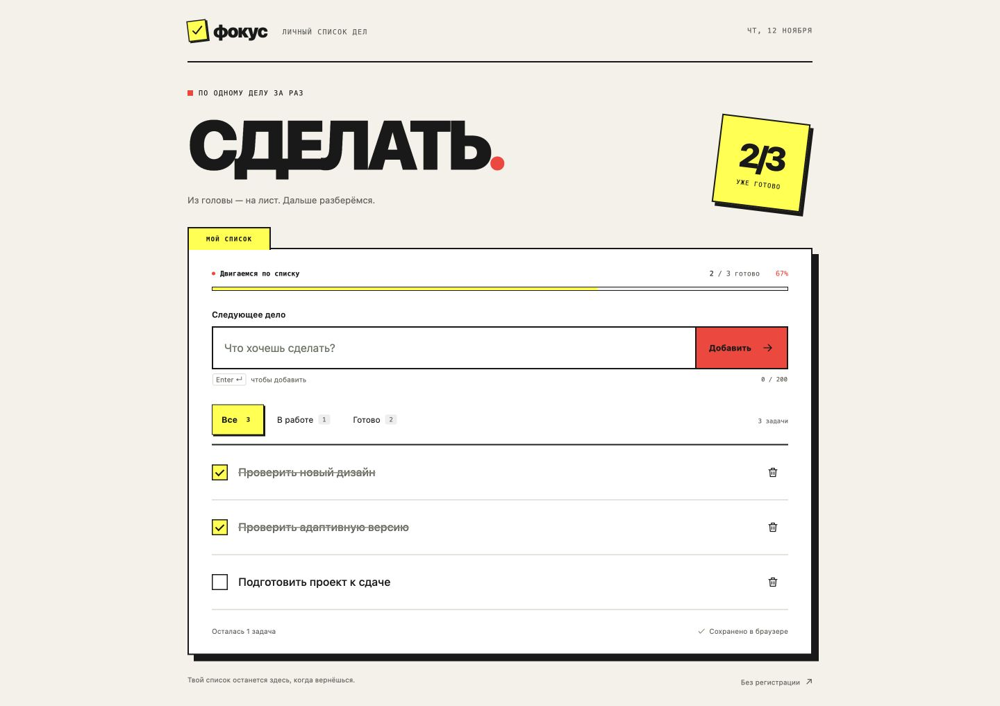

# Фокус

Список задач на HTML, CSS и JavaScript. Можно добавить задачу, отметить её выполненной и удалить. Список и отметки сохраняются в localStorage после обновления страницы.

Основной дизайн использует тему Brutalism из MagicPath: крупный заголовок, жёлтые акценты и чёткие контуры. [Бумажный вариант](https://petuxov15op-gif.github.io/focus-todo/paper.html) работает с тем же списком задач.

**[Рабочий сайт](https://petuxov15op-gif.github.io/focus-todo/)** · **[Код проекта](https://github.com/petuxov15op-gif/focus-todo)**



## Запуск

Сборка и установка пакетов не нужны. Из папки проекта запусти:

```bash
python3 -m http.server 4173 --bind 127.0.0.1
```

Открой `http://127.0.0.1:4173` в браузере. Остановить сервер можно сочетанием Ctrl+C.

Используй локальный сервер или HTTPS-хостинг. При открытии через `file://` поведение хранилища зависит от браузера.

## Возможности

- Добавление кнопкой или Enter.
- Отметка выполнения и возврат задачи в работу.
- Удаление с возможностью вернуть последнюю удалённую задачу до обновления страницы.
- Сохранение списка и статусов в localStorage.
- Фильтры "Все", "В работе" и "Готово".
- Счётчик задач и прогресс выполнения.
- Адаптивная вёрстка и управление с клавиатуры.
- Проверка пустого ввода, лимит 200 символов и безопасный вывод текста.
- Обновление списка между открытыми вкладками одного сайта.
- Предупреждение, если браузер не разрешает сохранить изменения.

При первом запуске список пустой. Данные остаются в браузере пользователя: приложение не отправляет задачи на сервер и не синхронизирует их между устройствами. Очистка данных сайта удаляет сохранённый список. Для задач на другом адресе сайта используется отдельное хранилище.

## Структура

```text
index.html         Разметка и элементы интерфейса
styles.css         Оформление и адаптивность
bold.css           Оформление на основе темы Brutalism из MagicPath
paper.html         Альтернативный бумажный вид
app.js             Логика, фильтры и сохранение
favicon.svg        Иконка сайта
screenshots/        Скриншоты основного дизайна на компьютере и телефоне
README.md          Описание и запуск
TESTING.md         Проверенные сценарии и шаги повторной проверки
DESIGN.md          Визуальное решение и примеры
```

Внешних библиотек, шрифтов, трекеров и API нет. localStorage достаточно для заданного функционала, поэтому серверная часть не нужна. При одновременных изменениях в нескольких вкладках сохраняется последний записанный список.

## Проверка

Основные сценарии проверены через интерфейс браузера: добавление, выполнение, снятие отметки, удаление и сохранение после перезагрузки. Также проверены фильтры, отмена удаления, длинный текст, HTML-ввод и обновление между вкладками. Подробности в [TESTING.md](TESTING.md).

Для проверки синтаксиса JavaScript, если установлен Node.js:

```bash
node --check app.js
```

## Использование AI

Проект создан с помощью OpenAI Codex в приложении ChatGPT. AI использовался для подготовки дизайна, написания HTML/CSS/JavaScript и проверки сценариев через браузер. Стек выбран без фреймворков, чтобы проект было легко запустить и разобрать.

Два интерактивных варианта дизайна собраны и проверены через MagicPath MCP. Основное оформление перенесено из варианта на основе доступной в MagicPath темы Brutalism в локальный HTML/CSS-проект. React-прототипы MagicPath не нужны для запуска этого сайта.

## Размещение

GitHub Pages публикует корень ветки `main`. Команда сборки не требуется: все файлы работающего сайта находятся в корне проекта.
